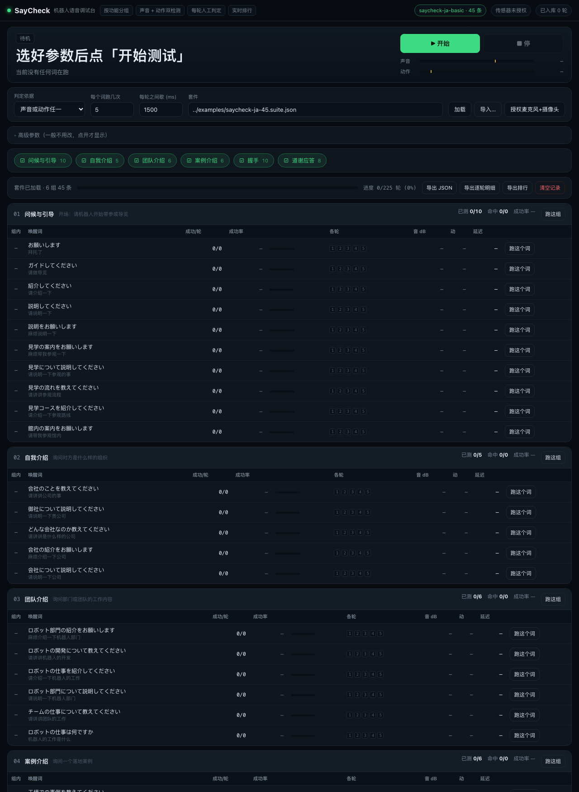
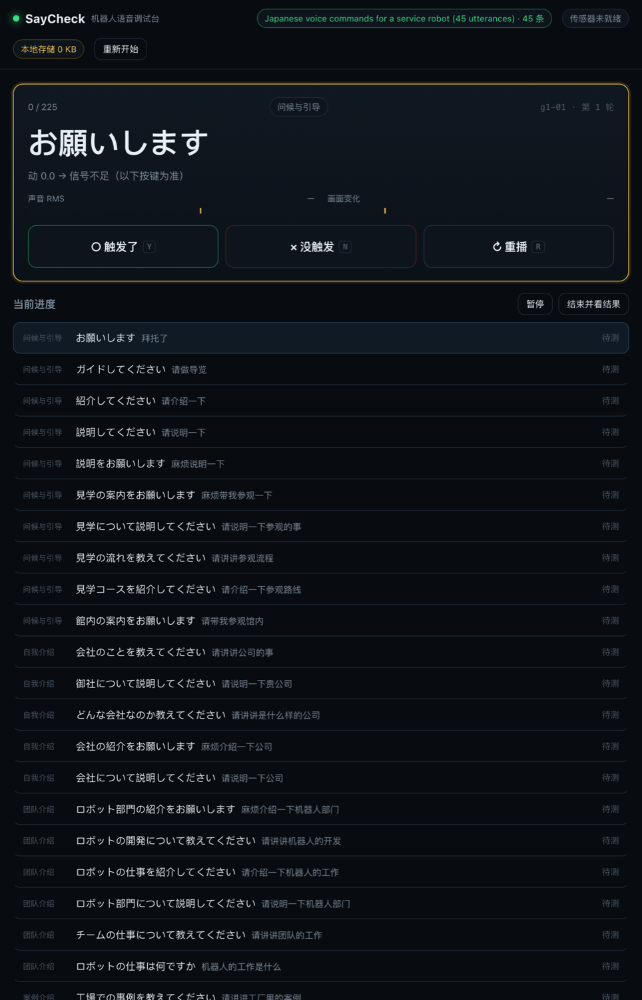
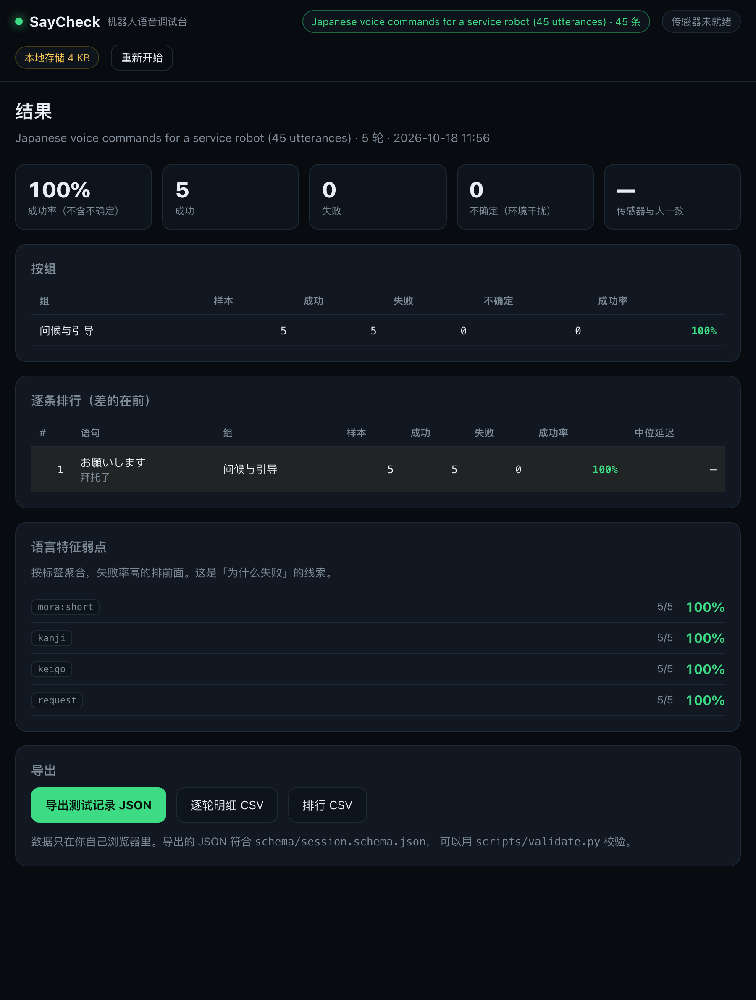

# SayCheck

**A voice test harness for robots. Zero integration.**

Point a phone at a robot. SayCheck plays a list of phrases, watches and listens
for a response, and gives you a pass-rate table — no SDK, no firmware changes,
no protocol reverse-engineering.

[中文说明](README.zh-CN.md)

```
  phone on a tripod                robot
  ┌──────────────┐                ┌───────┐
  │  SayCheck    │  plays audio → │       │
  │  mic + cam   │ ← listens/sees │       │
  └──────┬───────┘                └───────┘
         │  pass / fail per round
         ▼
   pass-rate table + CSV
```

---

## Why this exists

Testing whether a robot actually hears you is still done by hand: say the same
phrase ten times, tally the hits on paper, repeat for every phrase, every
language, every firmware build.

The reason nobody automated it is that every robot's voice pipeline is closed.
Wake-word engine, ASR, TTS, motion triggers all live inside the device.

SayCheck sidesteps the whole problem. It does not connect to the robot at all.
It measures the robot the way a human would — with a microphone and a camera —
and turns that into numbers.

That also means it works on **any** robot. Different vendor, different language,
different form factor: same workflow.

---

## How a verdict is reached

Three signals, no machine learning in the loop:

| Signal | What it catches | Failure mode |
|---|---|---|
| Mic RMS peak vs. room baseline | Did the robot make a sound? | Loud rooms |
| Camera frame difference | Did it move? | Poor lighting |
| One keypress (Y / N / R) | Was the response *correct*? | Human is slow |

The LLM is deliberately **not** in this loop. An LLM judging "did it respond"
adds latency, cost, and unexplainable errors to a question that a decibel
threshold answers deterministically.

Where an LLM does earn its place:

- **Generating** the test set — one intent expanded into 20 phrasings per language
- **Explaining** the result — "all 12 failures were 13+ mora" after the run

Deterministic judging, generative authoring.

---

## Two file formats

Everything else in this repo is a renderer for these two schemas.

**[`schema/suite.schema.json`](schema/suite.schema.json)** — the test set

```json
{
  "schemaVersion": "1.0",
  "id": "saycheck-ja-basic",
  "title": "Japanese voice commands (45 utterances)",
  "locale": "ja-JP",
  "groups": [{ "id": "g1", "name": "Greeting", "scene": "opening" }],
  "utterances": [{
    "id": "g1-01",
    "groupId": "g1",
    "text": "お願いします",
    "translation": "Please",
    "tags": ["mora:mid", "keigo", "request"],
    "audio": { "path": "audio/g1-01.wav", "provider": "irodori" }
  }]
}
```

**[`schema/session.schema.json`](schema/session.schema.json)** — one run

```json
{
  "schemaVersion": "1.0",
  "suiteId": "saycheck-ja-basic",
  "sessionId": "2026-10-18T19:20:00+08:00",
  "thresholds": { "rmsPeakDb": -38, "frameDiff": 6, "windowMs": 3000 },
  "trials": [{
    "utteranceId": "g1-01",
    "round": 1,
    "metrics": { "peakRmsDb": -31.2, "frameDiff": 2.1, "latencyMs": 820 },
    "sensorVerdict": "pass",
    "humanVerdict": "pass",
    "agreement": true
  }]
}
```

Thresholds are stored **inside every session**. Without them, readings from
different rooms and different phones are not comparable.

`sensorVerdict` and `humanVerdict` are stored **separately**, so the tool can
report how often the sensor agreed with the human. Below 80% means the
thresholds need tuning — and you will know that instead of guessing.

---

## Tags are the point

Every utterance carries linguistic tags: mora count, kanji, loanwords, keigo,
question form, numbers.

That is what turns a pass-rate table into an answer:

```
g5  handshake        8/10   80%
g2  self-intro       2/5    40%   ← 3 failures, all "mora:long"
```

Now you know the problem is phrase length, not the handshake skill.

TTS compression matters here too: the example audio ships as **48 kHz WAV, not
MP3**. Lossy encoding changes the acoustic features the wake-word engine sees,
which would silently bias your results.

---

## Engines

| Engine | Languages | Licence | Runs on |
|---|---|---|---|
| [Irodori-TTS](https://github.com/Aratako/Irodori-TTS) | Japanese | MIT | GPU |
| [Chatterbox Multilingual](https://github.com/resemble-ai/chatterbox) | 23 incl. ja, zh, en, ko | MIT | GPU |
| [Kokoro-82M](https://github.com/hexgrad/kokoro) | 10 incl. ja, zh, en, ko | Apache-2.0 | **CPU** |

Irodori is Japanese-only — it was trained on a single-speaker Japanese corpus,
so feeding it English produces Japanese-accented English. Multilingual needs a
real multilingual model.

You do not need any of these to use SayCheck. Bring your own audio, or record
a human saying the phrase. The harness only needs files it can play.

---

## Quick start

```bash
git clone https://github.com/l2ktech/saycheck
cd saycheck
python3 -m http.server 8000
```

Open **http://localhost:8000/web/**, allow microphone and camera, press
**开始测试**. Forty-five phrases, five rounds each — about six minutes.

A local server is required, not optional: browsers refuse `fetch()` on
`file://` URLs, and microphone access needs a secure context (`localhost`
counts as one).

Validate data without opening a browser:

```bash
python3 scripts/validate.py suite examples/saycheck-ja-45.suite.json
python3 scripts/validate.py session examples/sample.session.json
```

Build your own suite from an internal phrase list:

```bash
python3 scripts/anonymize_suite.py \
  --candidates my-phrases.json \
  --map        my-secrets.map.json \
  --audio-src  my-tts-output \
  --out        examples/my-robot-ja.suite.json \
  --suite-id   my-robot-ja \
  --title      "My robot, Japanese"
```

`my-secrets.map.json` holds the customer-name substitutions. It is gitignored
on purpose — the map never ships.

---

## What it looks like

**Setup** — pick a suite, choose which groups to run, tune the thresholds.



**Run** — one phrase at a time, live level meters with the detection threshold
marked in amber, and a single keypress to decide. The sensor's own verdict is
shown beside yours, not instead of it.



**Results** — pass rate, by group, per utterance, and the linguistic tags that
correlate with failure.



---

## Repo layout

```
schema/     the two JSON schemas (the actual product)
scripts/    validate.py · anonymize_suite.py
examples/   45 anonymized Japanese utterances + 48 kHz audio + a sample session
web/        browser runner (v0.2)
server/     optional OpenAI-compatible TTS proxy (v0.3)
docs/       design notes
```

---

## Roadmap

| Version | Scope |
|---|---|
| **v0.1** ✅ | Schemas, validator, anonymizer, 45-utterance example set |
| **v0.2** ✅ | Browser runner: play → mic/camera detect → one-key verdict → pass-rate table → CSV export |
| **v0.3** | OpenAI-compatible `/v1/audio/speech` proxy, so any TTS engine can feed a suite |
| **v0.4** | Multi-language example sets (en, zh, ko) |
| **later** | Community leaderboard via PRs — no backend, GitHub Actions recomputes a static JSON |

---

## Privacy

Test data lives in your browser. There is no account, no upload, and no server
that stores your recordings.

- Trial metrics → `localStorage` (a 90×10 run is about 60 KB)
- Audio → `IndexedDB`, **off by default**, only failed rounds when enabled
- Reports → files you download

`no audio leaves your browser` is a design constraint, not a policy promise.

---

## Tests

Two dependency-free suites, both run in CI on every push:

```bash
python3 -m unittest discover -s tests -p 'test_*.py' -v   # 18 tests: validators, checksums, bundled examples
node --test tests/*.test.mjs                              # 11 tests: pass-rate maths, CSV escaping
```

The Node suite pins the rules that quietly ruin a report if they drift:
`inconclusive` never counts as a failure, the human verdict overrides the
sensor's, and agreement is only computed where both exist.

The Python suite exercises the real CLIs through `subprocess` — a validator that
only ever prints OK is indistinguishable from `cat`.

---

## Licence

MIT. Example audio generated with Irodori-TTS (MIT).
