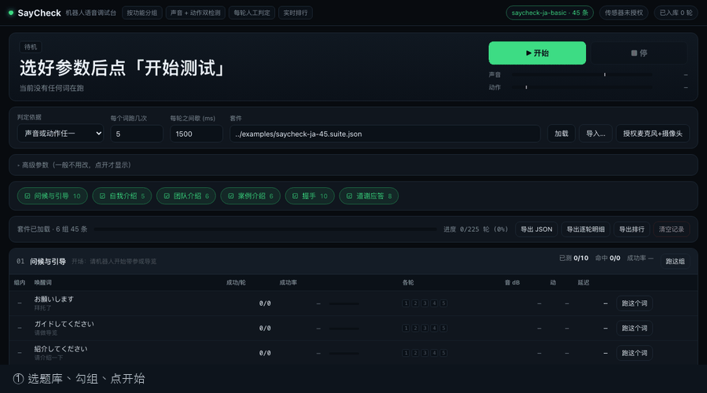

# SayCheck · 机器人语音调试台

**零集成。把手机架在机器人前面，就能测它的语音。**

SayCheck 自动播放一组测试语句，用麦克风和摄像头判断机器人有没有响应，
最后给你一张成功率表。不改固件、不接 SDK、不逆向协议。

[English](README.md)

```
  手机架在三脚架上              机器人
  ┌──────────────┐
  │  SayCheck    │  播放测试语音 →
  │  麦克风+摄像头 │  ← 听声音 / 看动作
  └──────┬───────┘
         │  每轮 pass / fail
         ▼
   成功率排行 + CSV
```

---

## 为什么做这个

调试一台语音机器人，现在还是手工活：同一句话念十遍，纸上划正字，
换个词重来，换门语言重来，固件升级后再重来一遍。

没人自动化的原因是：**每家机器人的语音链路都是封闭的**。唤醒词引擎、ASR、
TTS、动作触发全在设备内部，外部拿不到逐句的判定信号。

SayCheck 绕开了这件事——它**根本不连机器人**，而是像人一样，用麦克风和
摄像头去观察，再把观察变成数字。

所以它对**任何**机器人都成立。换品牌、换语言、换形态，流程一模一样。

---

## 判定怎么来的

三个信号，判定环节没有机器学习：

| 信号 | 判断什么 | 失效场景 |
|---|---|---|
| 麦克风 RMS 峰值 vs 环境基线 | 机器人有没有出声 | 环境太吵 |
| 摄像头帧差 | 有没有做动作 | 光线太暗 |
| 一个按键（Y / N / R） | 答得**对不对** | 人反应慢 |

**大模型不参与判定**。让 LLM 判断"它响应了吗"，是给一个用分贝阈值就能确定
回答的问题，加上延迟、成本和不可解释的误差。

大模型在这两个位置才有价值：

- **生成题库**：一个意图扩写成 20 种说法，每种语言一份
- **解释结果**：跑完之后告诉你"失败的 12 条全是 13 拍以上"

确定性判定，创造性生成。

---

## 两个文件格式

这个仓库其余部分，都只是这两个 schema 的渲染器。

**[`schema/suite.schema.json`](schema/suite.schema.json)** —— 测试题库

**[`schema/session.schema.json`](schema/session.schema.json)** —— 一次测试记录

两个设计细节值得单独说：

**阈值写进每一条记录。** 不同房间、不同手机测出来的分贝，不加阈值就没法比较。

**传感器判定和人工判定分开存。** 这样才能算出"传感器与人一致率"。低于 80%
说明阈值该调了——你会知道这件事，而不是靠猜。

---

## 标签才是关键

每条语句都带语言特征标签：拍数、汉字、外来语、敬语、疑问句、数字。

正是这些标签把"成功率表"变成"答案"：

```
g5  握手        8/10   80%
g2  自我介绍     2/5    40%   ← 3 次失败，全是 mora:long
```

于是你知道问题出在句子长度，不是握手技能。

同理，示例音频用 **48kHz WAV，不用 MP3**。有损压缩会改变唤醒词引擎看到的
声学特征，悄悄把你的测试结果带偏。

---

## 引擎

| 引擎 | 语言 | 许可 | 跑在哪 |
|---|---|---|---|
| [Irodori-TTS](https://github.com/Aratako/Irodori-TTS) | 仅日语 | MIT | GPU |
| [Chatterbox Multilingual](https://github.com/resemble-ai/chatterbox) | 23 种，含日中英韩 | MIT | GPU |
| [Kokoro-82M](https://github.com/hexgrad/kokoro) | 10 种，含日中英韩 | Apache-2.0 | **CPU** |

Irodori 是单说话人日语语料训练的，喂英文只会得到"日语口音的英文"。
多语言必须用真正的多语言模型。

**但你不用装这些也能用 SayCheck。** 用自己的音频，或者真人录音都行——
这个工具只需要能播放的文件。

---

## 快速开始

```bash
git clone https://github.com/l2ktech/saycheck
cd saycheck
python3 -m http.server 8000
```

打开 **http://localhost:8000/web/**，允许麦克风和摄像头，点「开始测试」。
45 条、每条 5 轮，大约六分钟。

**必须起本地服务**，不能直接双击 HTML：浏览器禁止 `file://` 下的 `fetch()`，
而麦克风权限也要求安全上下文（`localhost` 算安全上下文）。

不开浏览器也能校验数据：

```bash
python3 scripts/validate.py suite examples/saycheck-ja-45.suite.json
python3 scripts/validate.py session examples/sample.session.json
```

从内部话术表生成一份可公开的题库：

```bash
python3 scripts/anonymize_suite.py \
  --candidates my-phrases.json \
  --map        my-secrets.map.json \
  --audio-src  my-tts-output \
  --out        examples/my-robot-ja.suite.json \
  --suite-id   my-robot-ja \
  --title      "My robot, Japanese"
```

`my-secrets.map.json` 放客户名替换规则，**被 .gitignore 排除**，
永远不会进仓库。

---

## 长什么样



**设置** —— 选套件、勾组、调阈值。


**运行** —— 一次一句，实时电平，琥珀色竖线是检测阈值，一个键决定结果。
传感器的判定显示在旁边做对照，而不是替代你的判断。


**结果** —— 成功率、按组、逐条，以及和失败相关的语言特征标签。


---

## 目录

```
schema/     两个 JSON schema（真正的产品）
scripts/    validate.py · anonymize_suite.py
examples/   45 条脱敏日语语料 + 48kHz 音频 + 一份示例记录
web/        浏览器运行器（v0.2）
server/     可选的 OpenAI 兼容 TTS 代理（v0.3）
docs/       设计说明
```

---

## 路线图

| 版本 | 内容 |
|---|---|
| **v0.1** ✅ | Schema、校验器、脱敏脚本、45 条示例 |
| **v0.2** ✅ | 浏览器运行器：播放 → 麦克风/摄像头检测 → 一键判定 → 排行榜 → CSV 导出 |
| **v0.3** | OpenAI 兼容 `/v1/audio/speech` 代理，任何 TTS 都能喂题库 |
| **v0.4** | 多语言示例集（英、中、韩） |
| **以后** | 社区榜：靠 PR 提交、GitHub Actions 重算静态 JSON，不建后端 |

---

## 隐私

测试数据在你自己浏览器里。没有账号、没有上传、没有服务器保存你的录音。

- 每轮指标 → `localStorage`（90 条 × 10 轮约 60 KB）
- 录音 → `IndexedDB`，**默认关闭**，开启后也只录失败的那几轮
- 报告 → 你自己下载的文件

`no audio leaves your browser` 是设计约束，不是一句政策承诺。

---

## 测试

两套零依赖测试，每次 push 都在 CI 里跑：

```bash
python3 -m unittest discover -s tests -p 'test_*.py' -v   # 18 个：校验器、校验和、自带示例
node --test tests/*.test.mjs                              # 11 个：成功率算法、CSV 转义
```

Node 那套专门盯住「一旦漂移就会悄悄毁掉报告」的规则：`inconclusive` 永远不算失败、
人工判定优先于传感器、一致率只在两者都存在时才计算。

Python 那套通过 `subprocess` 打真实 CLI——一个只会输出 OK 的校验器，
和 `cat` 没有区别。

---

## 许可

MIT。示例音频由 Irodori-TTS（MIT）生成。
